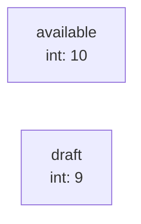
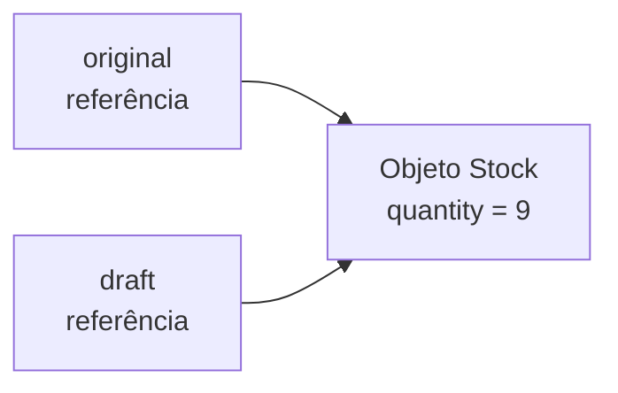
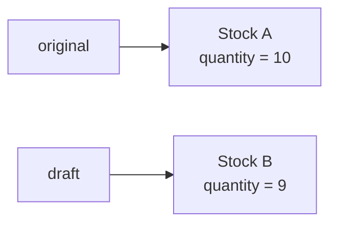
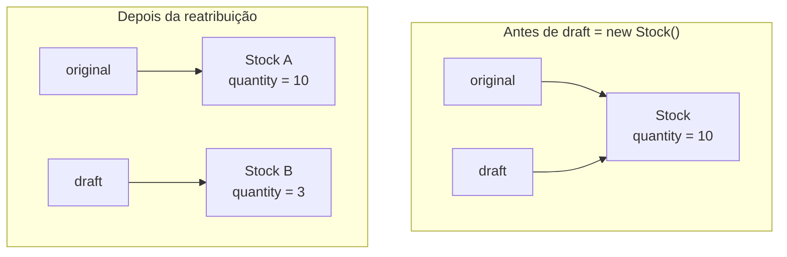

# Variáveis em Java. O que uma atribuição copia?

> **Java · Fundamentos** · 07/10/2026 · Java 21 · Leitura 01  
> **Assuntos:** Variáveis, referências, identidade, `final`

Uma simulação passa de 10 unidades para 9. Com `int`, o original continua em 10. Com uma referência a `Stock`, a mesma alteração pode mudar o que as duas variáveis enxergam.

Imagine uma simulação de estoque que começa com dez unidades disponíveis. A simulação remove uma unidade para mostrar quanto restaria depois de uma venda.

Antes de escolher como representar essa simulação, eu verificaria o que a atribuição realmente copia. Uma segunda variável pode guardar um número independente ou outra referência para o mesmo objeto. Em cada caso, a alteração tem um efeito diferente.

Este é um primeiro exemplo em Java. Ele usa Java 21, sem framework, banco de dados ou requisição HTTP. O estoque é um pequeno modelo local para investigar atribuição, não um sistema completo de reserva de estoque.

## Copiando um número

```java
public class PrimitiveCopyExample {
    public static void main(String[] args) {
        int available = 10;
        int draft = available;

        draft -= 1;

        System.out.println(available); // 10
        System.out.println(draft);     // 9
    }
}
```

`int available = 10` declara uma variável inteira chamada `available` e atribui a ela o valor inicial `10`. Já `int draft = available` lê esse valor e o usa para inicializar outra variável. A atribuição não cria um vínculo entre as duas.

A expressão `draft -= 1` subtrai uma unidade e guarda o resultado em `draft`. É uma forma mais curta de escrever `draft = draft - 1`. O programa imprime `10` e depois `9` porque só `draft` recebe o novo número.

As instruções terminam com ponto e vírgula e são executadas dentro das chaves de `main`, o ponto de entrada do programa. `System.out.println` imprime um valor em uma nova linha. Salve esse exemplo completo como `PrimitiveCopyExample.java`, para que o nome do arquivo corresponda ao da classe pública.

`int` é um tipo primitivo. Java também tem tipos primitivos como `boolean`, `long` e `double`. Uma variável de tipo primitivo guarda um valor primitivo. Duas variáveis primitivas não compartilham estado mutável só porque uma foi inicializada a partir da outra.



## Copiando uma referência

Agora a quantidade pertence a um objeto.

```java
public class Stock {
    int quantity = 10;
}
```

`class Stock` define um tipo cujas instâncias têm um campo inteiro chamado `quantity`. Cada `new Stock()` nestes exemplos cria um novo objeto, com `quantity` inicialmente igual a `10`. O campo pertence à instância, e não à variável local que guarda sua referência.

Mantenha essa declaração em `Stock.java`. Os próximos trechos entram em um método `main` que usa essa classe. O [código que acompanha o artigo](../../../../examples/java/variables-and-references/) contém um programa completo para cada trecho.

```java
Stock original = new Stock();
Stock draft = original;

draft.quantity -= 1;

System.out.println(original.quantity); // 9
System.out.println(draft.quantity);    // 9
System.out.println(original == draft); // true
```

`original` guarda uma referência para o novo objeto `Stock`. `Stock draft = original` copia o valor dessa referência. A atribuição não cria outro objeto de estoque nem copia seus campos.

A expressão `draft.quantity` segue a referência e acessa o campo do objeto. Subtrair uma unidade por esse caminho altera o objeto compartilhado. Ao ler `original.quantity`, seguimos outra referência para o mesmo objeto, então o resultado também é `9`.

Nessa comparação, `original == draft` verifica se as referências apontam para o mesmo objeto. O resultado é `true`.



As setas representam referências das variáveis para os objetos. O número guardado em uma variável primitiva não precisa dessa ligação.

## Quantidades iguais não significam o mesmo objeto

Criar duas instâncias muda o resultado.

```java
Stock original = new Stock();
Stock draft = new Stock();

System.out.println(original == draft); // false
System.out.println(original.quantity == draft.quantity); // true

draft.quantity -= 1;

System.out.println(original.quantity); // 10
System.out.println(draft.quantity);    // 9
```

As duas expressões `new Stock()` criam objetos diferentes. Ambos começam com o mesmo valor no campo, então comparar suas quantidades produz `true`. Comparar suas referências com `==` produz `false`.

Agora, alterar `draft.quantity` afeta apenas o segundo objeto. Não há uma instância de estoque compartilhada cuja alteração apareça também em `original`.



Eu usaria um valor independente nessa simulação se as alterações precisassem preservar o estoque atual. Para a única quantidade deste exemplo, copiar o `int` é suficiente. Criar um objeto separado também separa esse campo inteiro, mas um modelo maior precisa de uma regra clara para copiar cada campo. Criar um novo objeto externo não copia automaticamente os outros objetos referenciados por seus campos.

## Reatribuir a variável segue outro caminho

Trocar a referência guardada em `draft` é diferente de alterar um campo por meio dela.

```java
Stock original = new Stock();
Stock draft = original;

draft = new Stock();
draft.quantity = 3;

System.out.println(original.quantity); // 10
System.out.println(draft.quantity);    // 3
System.out.println(original == draft); // false
```

Inicialmente, as duas variáveis se referem ao primeiro objeto. Depois, `draft = new Stock()` guarda outra referência em `draft`. `original` mantém a referência anterior.

A próxima atribuição muda a quantidade do segundo objeto para `3`. A quantidade do primeiro continua em `10`.



A diferença aparece no lado esquerdo da atribuição. `draft = ...` altera a variável local. `draft.quantity = ...` altera um campo do objeto acessado por essa variável.

## O que final mantém fixo

Adicionar `final` impede uma nova atribuição depois que a variável recebe seu valor.

```java
final Stock original = new Stock();
Stock draft = original;

original.quantity = 9;

System.out.println(original.quantity); // 9
System.out.println(draft.quantity);    // 9
```

O código compila e imprime `9` duas vezes. `final` mantém fixa a referência guardada em `original`. Isso não torna o objeto `Stock` imutável: seu campo `quantity` continua podendo ser alterado.

Se adicionarmos a linha abaixo ao mesmo método `main`, o compilador a rejeita.

```java
original = new Stock();
```

Mensagem de compilação (formato representativo; a localização depende do arquivo):

```text
error: cannot assign a value to final variable original
```

Uma variável primitiva segue a mesma regra. Se `available` for declarada como `final int available = 10`, atribuir outro inteiro a ela será rejeitado. Alterar uma variável `draft` independente continua permitido.

Eu usaria `final` aqui quando a variável precisasse manter a mesma referência durante toda a operação. Ainda seria necessário ter uma simulação independente se suas alterações precisassem preservar o estado do objeto original. Reatribuir uma referência e alterar um objeto são decisões separadas.

## Referências

- [Tipos e valores primitivos — JLS §4.2](https://docs.oracle.com/javase/specs/jls/se21/html/jls-4.html#jls-4.2)
- [Objetos e referências compartilhadas — JLS §4.3.1](https://docs.oracle.com/javase/specs/jls/se21/html/jls-4.html#jls-4.3.1)
- [Variáveis de tipo referência — JLS §4.12.2](https://docs.oracle.com/javase/specs/jls/se21/html/jls-4.html#jls-4.12.2)
- [Variáveis final — JLS §4.12.4](https://docs.oracle.com/javase/specs/jls/se21/html/jls-4.html#jls-4.12.4)

---

[← Índice de artigos](../../../../README.md) · [Exemplos executáveis](../../../../examples/java/variables-and-references/)
